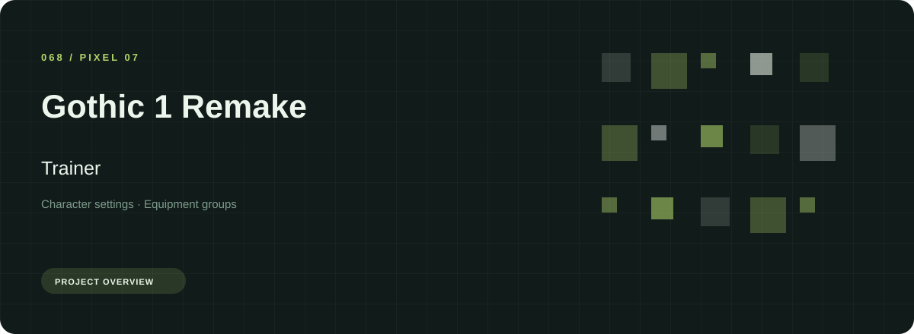
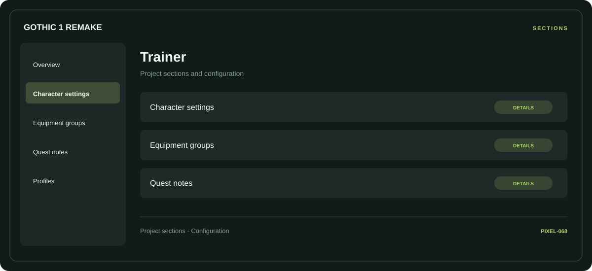

# 🛠️ Gothic 1 Remake Trainer

**Character settings · Equipment groups · Quest notes**

## ⚡ Features

Gothic 1 Remake Trainer uses a concise workspace for character settings, equipment groups, and quest notes. The feature map follows the same order as the project navigation.

### ⚙️ Character settings

Character-related parameters and the settings associated with the selected category.

### 🧩 Equipment groups

Equipment categories and the associated selection or configuration options.

### ⌨️ Quest notes

A dedicated section for quest notes and the configuration details associated with that area.

## 🖥️ Project navigation

## 📥 Download

The button and cover open the project's download page. Use the information supplied with the downloaded package for installation and release-specific requirements.

## 📚 Project documentation

- [Feature reference](docs/FEATURES.md)
- [Download information](docs/DOWNLOAD.md)
- [Project page](index.html)

---

Gothic 1 Remake Trainer · Program documentation and download information.
